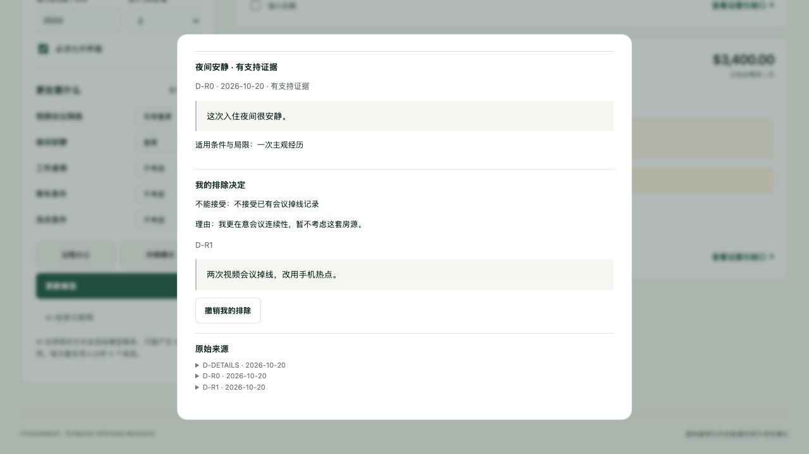
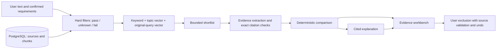

# ChoiceMatch

An evidence-informed recommendation prototype that helps users compare rental options, inspect trade-offs, and exclude candidates with unacceptable risks.

Built as an AI application engineering portfolio project, inspired by an earlier Airbnb analysis project and the difficulty of comparing rental information. Rentals are the implemented domain; short stays and cars are future extensions. This is a local prototype, not a live listing service. The current UI is in Chinese.



## Try it without an API key

From this directory, with Python 3.10 or later (development validation used Python 3.14):

```sh
python3 demo.py
python3 scripts/preview_lab.py
```

Open **http://127.0.0.1:8789/** for the rental workbench, or **http://127.0.0.1:8789/lab** for the retrieval experiment panel. This standard-library preview deliberately ignores model/database credentials, uses fictional fixtures, and exits after five minutes. Stop it earlier with Ctrl+C. It does not call a model or start a database.

Try the remote-work and vacation presets, inspect evidence, compare up to three candidates, and exclude a candidate with a cited reason. You can undo that decision. Changing requirements or refreshing clears session decisions; JSON export includes them.

For a guided walkthrough, see the [three-minute demo](docs/demo-guide.md). For the optional model/database path, see [setup](docs/setup-en.md).

## What is implemented

- **Three-state hard filtering:** pass, fail, or unknown. Missing monthly fees remain unknown; a known cost lower bound can still rule out an over-budget option.
- **Persistent evidence retrieval:** PostgreSQL, pgvector, text search, source-aware chunks, and content-hash invalidation when sources change.
- **Query-aware retrieval:** fixed topic keyword/vector routes plus a separate vector route for the original question. Details remain in the original text rather than an expanding request schema.
- **Bounded RAG:** retrieve at most five candidates for extraction, validate exact quotations and source IDs, then generate explanations constrained to the resulting evidence.
- **Auditable recommendations:** preserve both support and risk, distinguish missing information, and keep deterministic scoring authoritative over model explanations.
- **User-controlled exclusions:** source-backed choices validated against current requirements and source hashes, with reasons, undo, and export. These are user choices, not certified facts.
- **Reproducible experiments:** frozen synthetic cases, stored protocols/results, offline weight analysis, and recorded negative results.

The retrieval score measures relevance; the recommendation score reflects evidence direction. Neither is a calibrated probability that a property will satisfy a user.

## Architecture



The no-key demo uses hand-authored evidence and deterministic rules. The diagram describes the optional PostgreSQL-backed model path. See [architecture and boundaries](docs/architecture.md).

## What the experiments taught us

| Experiment | Observed result | Decision |
| --- | --- | --- |
| Keyword vs. vector vs. hybrid retrieval, 30 synthetic documents | Recall@5: 50%, 95%, 80% respectively | Do not assume hybrid always improves recall. |
| Original-query addition, six synthetic scenarios | The default 20% contribution did not improve scenario recall@5 | Preserve the result; do not claim a retrieval gain. |
| Candidate-rank fusion, eight new synthetic scenarios | Scenario recall rose from 26.7% to 33.3%, but the predeclared gate failed | Keep the default fusion unchanged. |
| Source relevance v2, 16 synthetic materials | Raw outputs retained 5/6 risks; the fourth batch failed consistency validation | Do not enable automatic semantic exclusions. |

These are small, assistant-authored synthetic development evaluations, not independent human labels or production benchmarks. Test cases already inspected are not reused as unseen validation. [Retrieval report](docs/retrieval-evaluation.md), [fusion report](docs/fusion-evaluation-v2.md), [source audit](docs/source-relevance-v2.md).

The central product decision is to identify unacceptable conflicts, then recommend from the remaining evidence—without interpreting “no risk found” as “verified safe.” Structured hard conflicts are automatic; text-based exclusion remains under user control. The [decision history](docs/decisions/001-original-query-retrieval.md) records how this design evolved.

## Validation

```sh
python3 -m unittest discover -s tests -v
```

94 tests were last verified with the database enabled; the ordinary offline command skips five PostgreSQL integration tests. Tests cover filtering, source integrity, API contracts, retrieval fusion, review invalidation, and failure paths. They do not establish model accuracy. [Database test setup](docs/setup-en.md#tests).

Desktop browser checks cover exclusion, undo, required fields, and invalidation after changing the original request. Mobile and production deployment validation remain outstanding.

## Data and limitations

The public demo and evaluation fixtures are fictional. A local historical import contains 148 Chicago rental advertisements from 2019, not verified resident reviews or current availability; downloaded data and credentials are excluded from the repository. See [data provenance](docs/data-sources.md).

Exact citation matching does not prove semantic support or source truth. Shortlisting can miss relevant candidates, raw similarity can retrieve distractors, evidence can be stale, and automatic source relevance has not passed validation. The app is loopback-only with no production authentication or hosting. No Zillow/Redfin integration, live inventory, or automatic semantic risk filter is implemented.

## Project map

- `engine.py`, `rental.py`: hard constraints and evidence scoring
- `database.py`, `migrations/`, `hybrid.py`: storage, invalidation, retrieval
- `ai_pipeline.py`, `model.py`: model contracts and citation checks
- `risk_policy.py`, `server.py`, `web/`: user decisions and local workbench
- `evaluation/`, `tests/`: frozen experiments and regression coverage
- [Interview narrative](docs/portfolio-story.md) · [Release preparation](docs/release-readiness.md)

Earlier Chinese development notes are preserved in [development history](docs/development-history-zh.md); dated entries describe the state at that time.
