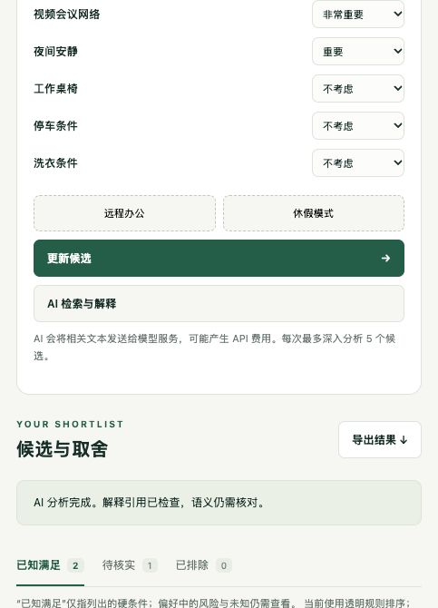

# 原问题路线对照验证：2026-11-19

## 结论

原问题向量确实改变了排序，但现有 80/20 融合未提高本次前五名场景证据召回：当前混合和混合加原问题均为 22.2%。单独原问题路线为 63.1%，说明存在可用的补充信号；该数值只是诊断基线，不代表已经实现了 63.1% 的生产召回，也不是推荐准确率。本轮没有依据结果调权重或修改融合算法。

## 固定的协议与范围

运行前固定 [12 条虚构来源、6 个问题](../evaluation/original_query_v1.json)，SHA-256 和代码哈希保存在 [原始报告](../evaluation/original-query-result-20261119T195310.json)。全部由开发助手编写，不是独立人工评估。

问题成对比较白天/凌晨、十分钟/四小时，以及简短场景/加入卧室预算宠物等描述的完整场景。每个候选只有一条短来源，所有候选结构化条件相同，使用一个 video_calls 主题，固定前五个候选/来源。这样隔离了资料数量、上下文长度、硬筛选差异的影响，但没有验证多主题覆盖优先或长文截断。

“场景相关”指明确谈及用户使用时间、时长或其证据局限，不等于泛泛网络主题相关，更不等于满足要求。例如“十分钟测试正常，未测试更长通话”与四小时问题的证据缺口有关；“提供 Wi-Fi”不足以描述使用场景。标签规则随语料一并冻结。长时间/凌晨场景可以由任一维度的证据部分支持，不能声称验证了全部细节或跨国性能。

旧版 30 条主题评估与本次的标签粒度、材料和问题都不同，不能把两轮百分比直接作为性能涨跌对比。看到本次结果后，该语料作为开发回归集，后续调参需要新的留出案例。

## 实测

| 方法 | 场景 Precision@5 | 场景 Recall@5 | 风险 Recall@5 |
| --- | ---: | ---: | ---: |
| 当前混合 | 10.0% | 22.2% | 33.3% |
| 固定主题向量 | 23.3% | 38.6% | 61.1% |
| 当前混合 + 20% 原问题 | 10.0% | 22.2% | 33.3% |
| 原问题向量单独使用（诊断） | 46.7% | 63.1% | 75.0% |

均为六个问题的宏平均。各个问题前五名的具体顺序、距离、分数及遗漏风险保存在原始 JSON。当前混合和新增路线融合的前五名集合在六例中相同，内部顺序有变化，因此新增有效来源、挤出的有效来源和挤出的风险均为零。

原问题单独检索也会犯错：“白天开会”问题下，中文凌晨风险仍排第一。本语料只有一条中文来源，其余多为英文，存在语言和措辞的混杂，不能将排序变化全部归因于时间细节。增加预算等长描述后，凌晨四小时场景的单独原问题召回从 80% 降至 40%，提示完整问题可能稀释场景重点，但只有这一对案例，不能外推。

## 为什么融合没有改善

本次所有候选都被主题向量返回，因此主题命中数相同，覆盖优先不是本次差异的主因。两路 RRF 归一化仍保留“单路命中”与“双路命中”的分差：

- `night-cn` 中文凌晨风险只有主题向量命中，主题分约 0.442；原问题分为 1，融合后约 0.554。
- `amenity` 只是 Wi-Fi 设施广告，两路都命中，主题分约 0.969；原问题分约 0.847，融合后仍约 0.945。

两者都归一化到 0—1，不意味着分布已经校准。RRF 常数 60 下，小语料排名的原问题归一分又比较接近；20% 的调整不足以弥补两路/单路差距。这是原实现的可解释结果，不是嵌入路线没有生效。

下一轮值得独立验证按候选排名融合、路线类别权重或相关性判断，而不是声称只需提高 alpha 就一定解决。保留当前实验结果和实现，先固定新对照协议，再运行新案例；不要在本次六个问题上寻找最优权重并当作泛化效果。

## 资源与数据库隔离

- 模型：text-embedding-3-small；没有生成模型调用。
- 实际 7 次嵌入请求，435 个输入 token，含语料和原问题；主题查询命中已有缓存。
- 上限：8 次调用、12 个文档、6 个问题、每文本 500 字符、响应 4 MiB、进程峰值 RSS 256 MiB、评估时间 180 秒；不自动重试。评估器在各步骤/调用前后检查 RSS 与时间；单次网络调用另有 45 秒超时。
- 实测峰值 RSS 51.09 MiB。未同时运行浏览器验证服务或其他评估任务。
- 仅向临时数据集写入向量，finally 清理自己的候选和导入记录。运行前后生产表计数一致。
- 嵌入客户端新增 4 MiB 响应读取上限；自动回归验证超限在 JSON 解码前被拒绝。

复现（会产生有限嵌入费用）：

```sh
.venv/bin/python evaluate_original_query.py
```

## 浏览器验证

实际在浏览器填写“我每天凌晨连续开四小时跨国会议，希望网络稳定。”并点击按钮，确认真实页面 JS → HTTP handler → RAG 参数完整传递。随后编辑原话，旧结果和导出按钮失效；切换休假模式清空原话，再次提交的 original_query 是空字符串。没有捕获到页面脚本错误。

该环节用 [本地传参测试服务](../scripts/verify_browser_transport.py) 替换模型/RAG执行，不加载 .env，不调用外部模型。因此验证的是页面交互和参数传递，不是完整真实生成效果。服务已停止，最大生命周期 180 秒。记录见 [捕获的请求](../evaluation/browser-transport-validation.json)。



回归测试 59 项全部通过，包括五项真实 PostgreSQL 集成测试；该次自动测试峰值 RSS 52.03 MiB，无付费请求。
