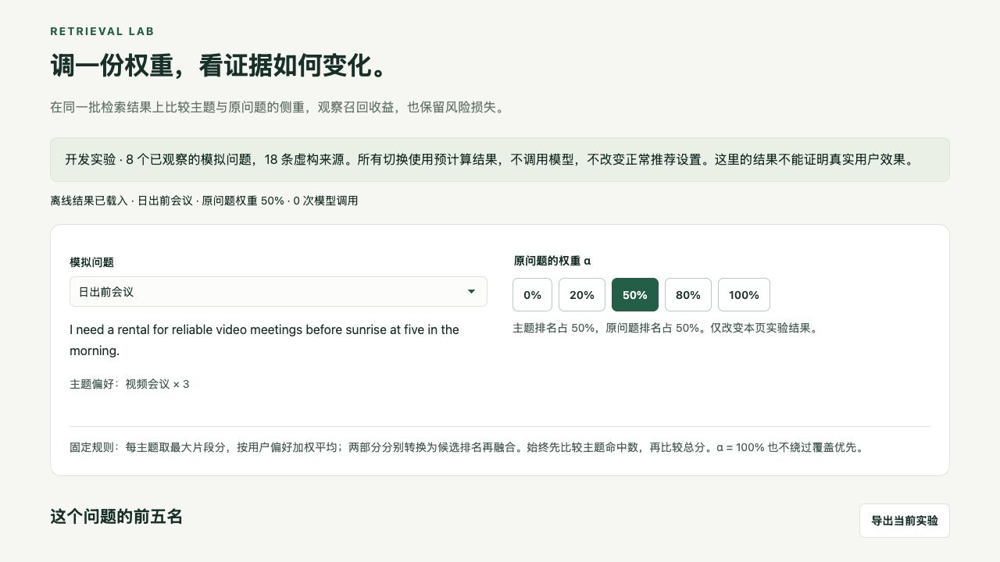

# 权重敏感性分析与检索实验室

本轮完成离线分析和开发演示面板，不改变正常推荐配置，不调用模型，不选择最优权重。

## 复现与打开

在 choice-match 目录运行：

```sh
.venv/bin/python analyze_weights.py
.venv/bin/python scripts/preview_lab.py
```

然后打开 http://127.0.0.1:8789/lab 。预览脚本不加载模型凭据，最多运行五分钟，结束可重新启动；运行完可 Ctrl-C 关闭。正常 ChoiceMatch 服务同样提供 `/lab`，首页有“检索实验”入口。本次 8767 已被另一个应用占用，所以只使用临时 8789，未停止或更改已有服务；浏览器验证结束后该临时服务已退出。

## 面板功能

- 选择八个已观察的模拟问题之一；不是接受任意用户输入的生产设置。
- 选择固定原问题权重 0%、20%、50%、80%、100%，主题权重为剩余部分。
- 展示该问题的前五个候选、虚构来源全文、相关性标签、场景/一般主题风险标签及分数构成。
- 与排名融合 20% 实验基线比较进入、退出、新增相关证据、新增风险和丢失风险。
- 同时显示八例宏平均与纯主题向量对照；不标记任何“推荐档位”。
- 导出当前问题、权重、来源排名、指标、实验范围和输入报告哈希。

所有交互仅切换已生成结果；加载一次约 116 KB 的合成数据，不请求模型或数据库。使用 textContent 展示文本，避免把来源当作 HTML 执行。服务仅通过明确静态路由提供该合成数据文件，不开放 evaluation 目录或任意路径读取。

## 方法与防止过拟合

使用上一轮保存的所有 18 个候选的主题分、原问题分和主题覆盖，从原始分重新计算候选排名信号，而非在已经截断的五个候选中重排。固定排名融合和覆盖优先，仅比较五档 alpha。每个来源一条短文，固定五个候选，沿用冻结标签。

脚本检查原语料哈希，并断言 20% 档的每例前五名与上次实测完全一致。输入文件每个不超过 1 MiB，输出不超过 500 KB，固定八例、18 个候选。生成物包含输入报告、语料和分析代码的 SHA-256。

这些案例已经看过结果，明确属于开发敏感性分析，不能当作新留出验证。五个点只是观察变化趋势，不自动选最大值，不追加精细权重搜索；如果后续选定方案，需要另用未参与选择的新案例验证。

## 实测表（开发集宏平均）

| 原问题权重 | 场景召回 | 场景风险召回 | 一般主题风险召回 | 场景召回下降例数 | 丢失风险例数 |
| --- | ---: | ---: | ---: | ---: | ---: |
| 0% | 26.7% | 33.3% | 40.8% | 2/8 | 5/8 |
| 20% | 33.3% | 50.0% | 49.7% | 0/8 | 0/8 |
| 50% | 56.7% | 52.1% | 45.1% | 1/8 | 3/8 |
| 80% | 55.0% | 41.7% | 32.4% | 1/8 | 7/8 |
| 100% | 59.2% | 54.2% | 33.5% | 1/8 | 7/8 |

下降和丢失均以**排名融合 20%**为参照，不是正常应用默认的原始分数融合。丢失风险统计某条既有来源离开前五名，即使有新的风险替代，仍然计入；因此平均风险召回和丢失例数需要一起阅读。所有百分比是检索指标，不是推荐准确率。

纯主题向量对照：场景召回 40.0%、场景风险召回 52.1%、一般主题风险召回 59.9%。50% 提高了场景召回，但一般风险召回低于 20% 和纯主题向量；80% 没有继续改善。不能因此宣布 50% 最优，也不能只看 100% 的场景召回而忽略风险损失。

100% 仍保留主题命中数优先，并非在任何数据规模下都等价于原问题单独检索。本批候选少且每主题都返回全部候选，因此覆盖数相同；更大候选池下需要单独检查此约束。

[完整敏感性结果](../evaluation/weight-sensitivity-v1.json) · [分析脚本](../analyze_weights.py)

## 验证与资源

68 项自动测试通过，含真实 PostgreSQL 集成测试；新增测试验证原排名重放、固定五档、零网络调用、差异集合、指标分母和覆盖优先。自动测试峰值 RSS 53.17 MiB；离线分析峰值 RSS 25.70 MiB。分析上限 256 MiB、30 秒，定时检查，超限停止且不重试。

浏览器实际验证：默认 20%、切换 50%、更换模拟问题、100% 边界、候选及风险变化、导出 JSON。读取实际导出文件确认权重为 1、问题为 six-hours、五个候选和零调用标记。页面未捕获脚本错误；本次桌面布局截图已检查，未另做移动端浏览器测试。



## 设计讨论的落点

用户提出让用户选择更关注主题还是原话细节。我们保留这个交互想法，但先作为开发演示工具：先展示可解释的取舍，不把未经验证的权重包装成正式“精准模式”，也不把调参责任直接交给普通用户。面试可展示同一检索快照如何在零额外模型成本下重放、对比和审计，以及为何一个更高的召回指标不足以自动决定上线配置。
